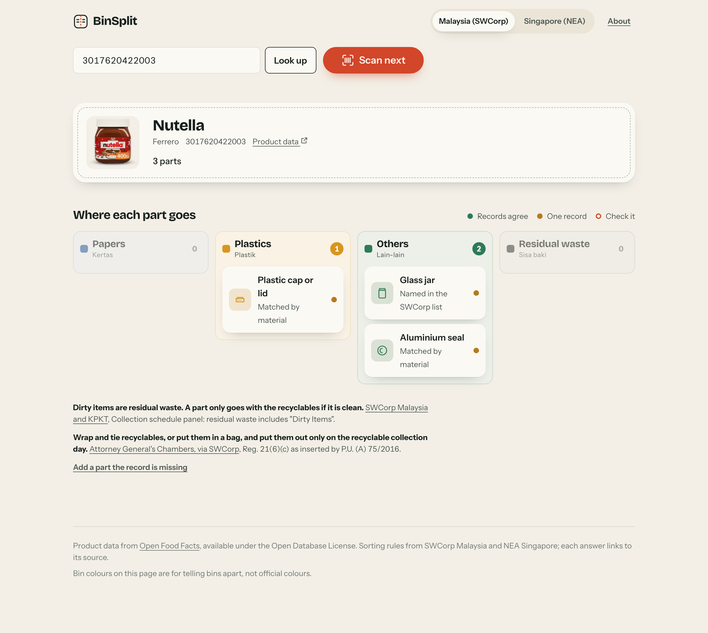

# BinSplit

**Every part. The right bin.** Scan a product's barcode and BinSplit splits its packaging into parts (bottle, cap, label, seal, carton, wrapper) and tells you which bin each part goes in under your area's official sorting rules, with the source for every answer.



## Why

Most products are packed in more than one material, and the right bin depends on the part and on where you live. A glass jar, its plastic lid and its aluminium seal go to three different places in one country and to one bin in the next. When people guess, recyclables end up in the wrong stream: NEA Singapore reports that "40% of the items in recycling bins cannot be recycled due to contamination" ([Know Your Contaminants](https://www.cgs.gov.sg/recycleright/know-your-contaminants/), page updated 25 June 2026).

Photo classifiers guess one answer for a whole object. BinSplit reads what the product is actually made of, part by part, and applies the written local rules.

## What it does

- **Lookup**: barcode from the camera, a photo, or typed. Decoding runs in the browser (native `BarcodeDetector` where available, ZXing otherwise). Product data comes from the [Open Food Facts](https://world.openfoodfacts.org) API.
- **Reconcile**: Open Food Facts stores packaging in several crowd-sourced fields that often disagree. BinSplit merges the structured `packagings` list, the free-text `packaging_text` (any language) and the shape/material tags into one list of parts, each with a confidence level: *records agree*, *one record*, or *check it*.
- **Ask, don't guess**: when the records conflict (a jar that is plastic in one field and glass in another) or one record lists a part the other never mentions, the part goes to **Needs your answer** with a one-tap question.
- **Sort**: each part is matched against a rule pack. A part only gets a bin if an official source says so. Otherwise it is shown as **Not covered here**, with the reason.
- **Sources**: tap a part to see the rule, the wording it encodes, whether the source names the item or only its material, and a link to the official document.
- **Switch area**: the same parts re-sort live under another rule pack.
- **No data?** Two taps (shape, then material) describe a part, and the same rules sort it.
- **Offline**: a static site with a service worker; products already looked up work without a network. No account, no server, no API key.

## Rule packs

Every rule carries its source, the location in it, and the date it was fetched. Rules that could not be sourced were left out.

| Pack | Applies to | Sources |
|---|---|---|
| **Malaysia (SWCorp)** | Households in the 7 states that adopted Act 672: Johor, Melaka, Negeri Sembilan, Pahang, Perlis, Kedah, and the Federal Territories (KL, Putrajaya). Not Selangor, Penang, Perak, Kelantan, Terengganu, Sabah or Sarawak. | SWCorp leaflet *Separate Waste: Separation of Solid Waste at Source* (EN and BM); SWCorp *Pengasingan Sisa Pepejal di Punca* page; P.U. (A) 307/2011 and P.U. (A) 75/2016 |
| **Singapore (NEA)** | Households using the blue recycling bins | NEA *Bloobin's Recycling Guide* (v6, summary table S/N 1 to 66); Clean & Green Singapore *Know Your Contaminants* |

Rules marked **named in the list** encode an item the source names (for example "Drink Cartons" under Papers). Rules marked **matched by material** apply the source's material category to an item it does not name (for example a plastic label under Plastics); the app says which one applies.

Not covered on purpose: polystyrene foam, foil-lined plastic and other composites in the Malaysia pack (the SWCorp leaflet does not mention them), and sachets and capsules in both packs.

The bin colours in the app are for telling bins apart on screen; they are not official colours.

## Coverage, measured

`npm run eval` runs a fixed list of real barcodes through lookup, reconciliation and both rule packs. The list is the most-scanned Open Food Facts products sold in Malaysia (top 150) and Singapore (top 100), duplicates removed: 240 barcodes, chosen without looking at their packaging data. Results are in [`data/eval/results.json`](data/eval/results.json); the fetched data is in [`data/eval/snapshot.json`](data/eval/snapshot.json) so the numbers can be re-checked offline (`npm run eval -- --offline`).

Measured 2026-11-24 (barcodes fetched live from the Open Food Facts API):

| | Malaysia (SWCorp) | Singapore (NEA) |
|---|---|---|
| Barcodes tested | 240 | 240 |
| Found in Open Food Facts | 237 | 237 |
| With any packaging data | 95 (39.6%) | 95 (39.6%) |
| **Every part** sorted | 49 (20.4%) | 51 (21.3%) |
| **Some parts** sorted | 23 (9.6%) | 20 (8.3%) |
| **None** | 168 (70%) | 169 (70.4%) |
| At least one part sorted, among products with packaging data | 72 of 95 (76%) | 71 of 95 (75%) |

Across all products, 139 packaging parts were reconstructed: 6 where the records agree, 84 from one record, 49 marked "check it".

*Every part*: every part got a bin from a sourced rule and none is low confidence. *Some parts*: at least one part got a bin. *None*: no packaging data, or nothing that the rules cover.

The main limit is data, not rules: many popular products have no packaging information in Open Food Facts yet. That is why the two-tap path exists, and why the app links each product to its Open Food Facts page, where anyone can add the missing packaging.

## Run it

Requires Node.js 22.18 or newer (the scripts are TypeScript run directly by Node).

```sh
npm install
npm run dev          # http://localhost:5173
npm test             # unit tests: taxonomy, rules, reconciler on saved real products
npm run build        # static site in dist/
npm run preview      # serve the build
```

No environment variables or keys are needed.

Other scripts:

```sh
npm run taxonomy                 # rebuild src/data/taxonomy.json from data/off-taxonomy/
npm run eval                     # coverage evaluation (live, resumable; --offline to reuse the snapshot)
node scripts/smoke.ts URL        # browser smoke test with screenshots (needs Playwright's Chromium and ffmpeg)
node scripts/offline-check.mjs URL   # the built site reloads offline (run against npm run preview)
node scripts/record-demo.ts URL  # records assets/demo.mp4 from the running app (macOS `say` + ffmpeg)
```

### Deploy to GitHub Pages

The build uses relative paths, so it works from any sub-path. `.github/workflows/pages.yml` tests, builds and publishes `dist/` on every push to `main`. In the repository settings, set **Pages > Source** to **GitHub Actions**.

## How it is built

- TypeScript, Vite, no framework. Plain DOM rendering with a FLIP animation helper for the split-and-sort motion.
- `src/core/taxonomy.ts`: Open Food Facts packaging taxonomies (310 materials, 125 shapes, about 3,100 names in many languages) mapped to canonical classes by walking each entry's parents. Built by `scripts/build-taxonomy.ts`.
- `src/core/reconcile.ts`: merges the packaging fields into parts. Two passes (exact shape, then the lone remaining container), conflicts kept as alternatives, parts that only one record mentions flagged.
- `src/core/rules.ts`: rule engine. Most specific match wins (material and shape, then material); a rule beats a gap at the same level; if the shape is unknown it only answers when the shape could not change the answer.
- `src/packs/*.json`: the rule packs, one rule per source item, each with source id, reference and specificity.
- `scripts/coverage.ts`: the evaluation. `scripts/select-barcodes.ts`: how the barcode list was chosen.
- Design notes: [DESIGN.md](DESIGN.md).

## Known limits

- Two rule packs only. Selangor (where many Klang Valley residents live) runs its own scheme, and no official item list was found for it, so it is not included.
- Open Food Facts data is crowd-sourced. BinSplit shows confidence and asks when records conflict, but a record that is wrong in every field will give a wrong part list. You can correct any part in its detail sheet.
- The rule packs follow the published guidance as of the fetch date (2026-11-24). Local collectors may accept more or less.
- The camera scanner needs a browser with camera access over HTTPS (GitHub Pages is fine). It was tested with Chromium's fake camera, not yet on a real phone.

## Data and licences

- Code: MIT, see [LICENSE](LICENSE).
- Product data and packaging taxonomies: © Open Food Facts contributors, [Open Database License](https://opendatacommons.org/licenses/odbl/1-0/). Product images: CC BY-SA.
- Rule packs are short paraphrases of public government guidance, linked to the originals.
- Fonts: Bricolage Grotesque and Instrument Sans (SIL Open Font License), via Fontsource.
